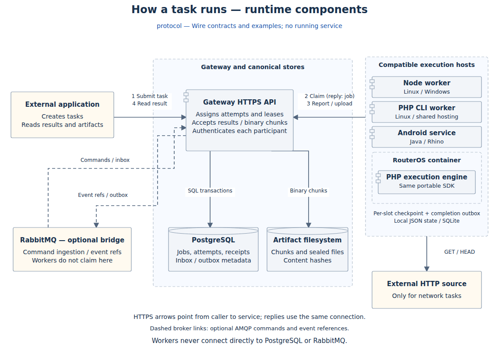
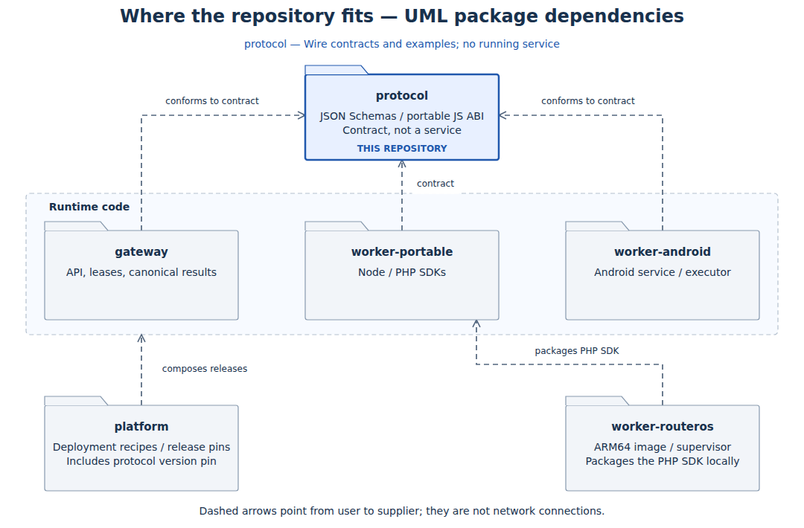

# Distributed Workers protocol

Portable job, completion, durable effect journal and streaming artifact formats.

<!-- fleet-architecture:start -->
## Architecture

### How a task runs



1. An external application submits a task to the gateway API.
2. A compatible worker claims it; the API assigns a fenced attempt in PostgreSQL and returns the task. The worker renews its lease while running.
3. The worker uploads binary output and submits its result. Gateway acknowledgements confirm persisted state.
4. The application reads the canonical result and downloads referenced artifacts.

Workers initiate HTTPS connections. PostgreSQL schedules claims and stores canonical execution state. RabbitMQ is an optional command/event bridge; workers do not pull their tasks from it. The four adapter boxes show implementation types, not a machine count.

### Where this repository fits



The **blue package labelled THIS REPOSITORY** is owned here. Dashed arrows point from a package to the contract, SDK or release bundle it uses; they do not represent network calls. `protocol` and `platform` are source/tooling packages, not running services. RouterOS packages the PHP SDK inside its own container rather than calling a separate PHP service.

This repository owns the wire schemas, portable JavaScript ABI, task/receipt examples and conformance/measurement tools. It is a contract and tooling package, not a queue server or another execution worker.

Implementation: [wire contract](PROTOCOL.md), [JSON Schemas](schemas/), [jobs](examples/), [example runner](tools/run-examples.py).

Editable sources: [runtime SVG](docs/architecture.svg), [runtime DOT](docs/architecture.dot), [repository SVG](docs/repositories.svg), [repository DOT](docs/repositories.dot). Both view families come from the shared model in [platform](https://gitflic.ru/project/distributed-workers/platform); each repository changes only the ownership highlight. PNG previews display on all three forges. Regenerate with `python3 -B tools/render-architecture.py --workspace ../.. --png` from the platform checkout. SVG needs Python alone; PNG needs local Chromium and Pillow.
<!-- fleet-architecture:end -->

- [Wire contract v1](PROTOCOL.md)
- [Connection resource profile](schemas/worker-profile.schema.json)
- [JSON Schemas](schemas/)
- [Runtime choices and primary references](RUNTIMES.md)
- [Compute example](examples/job.json)
- [Opt-in native command example](examples/command.json)
- [Portable JS + HTTP example](examples/javascript-http.json)
- [PHP-compatible declarative download](examples/http-artifact.json)
- [HTTPS conformance probe](tools/probe-api.py)

The additive v1 HTTP/artifact extension preserves existing computation jobs and
`run(input,resume)`. The portable JS ABI is `run(input,resume,ctx)`, synchronous
ES5.1, advertised as `javascript.portable.v1`. New `ctx` jobs require that
capability to exclude older executors during rolling updates. PHP without a JS
engine can execute declarative HTTP work. Capability
advertisement describes actual adapter support, not a claim that every task runs
on every operating system. Adapter implementations and real-device acceptance
belong to their component repositories.

## Verification

Run `python3 -B -m unittest discover -s tests -v` (requires `jsonschema`) for
schema/fixture and probe transport checks. The optional `--network-artifacts`
probe exercises the new journal/chunk routes against an explicitly configured
isolated gateway; it does not perform vendor HTTP requests.

Copy `probe.example.json` to ignored `.local/probe.local.json` and configure the
API base and local admin-secret path. `python3 -B tools/probe-api.py --check`
validates settings without any API request. Running without `--check` creates a
unique capability-scoped fixture so it consumes no TV or other workers' jobs.
Do not publish settings, credentials or private endpoint values.

<!-- fleet-examples:start -->
## Runnable examples and measured results

A local computation needs no source service:

```json
{
  "operation": "sha256",
  "input": {
    "text": "abc"
  },
  "required_capabilities": [
    "sha256"
  ]
}
```

Expected result: `{"sha256":"ba7816bf8f01cfea414140de5dae2223b00361a396177a9cb410ff61f20015ad"}`. The same task runs on Node, PHP and Android.

The [binary download example](https://github.com/hawkab/distributed-workers-protocol/blob/main/examples/mirror-download.json) fetches a public signed runtime ZIP and streams it to gateway artifact storage. Its expected SHA-256 is pinned in [the example assertions](https://github.com/hawkab/distributed-workers-protocol/blob/main/examples/benchmark/expected.json). The runner downloads the sealed artifact independently and verifies every byte. Worker task payloads are not staged as local files.

Run the shared client as a **producer/operator with an administrator credential**, not with a worker token. From this checkout:

```sh
mkdir -p .local
cp examples/benchmark/runner.example.json .local/examples.local.json
# Configure your API base and an owner-readable token file in that local JSON.
python3 -B tools/run-examples.py \
  --config .local/examples.local.json \
  --state .local/example-run/state.json \
  --output .local/example-run/measurements.json \
  --scenario sha256 --scenario mirror-download --repetitions 5
```

Repeat the command to resume its saved jobs after interruption. It reconciles the same idempotency keys, retains failed/interrupted evidence, and never gives a running job an overall deadline. `required_capabilities` and `resource_requirements` select a pool; `allowed_worker_ids` checks the actual executor afterward. A label alone does not select a platform. Keep these routing settings and all identity receipts private. The exported measurements contain neither endpoints, credentials nor worker/job IDs.

Measured 26–27 November 2026 (UTC+03), using SDK 0.8.4 and Android 0.8.0.

| Executor | Task | Completed / planned | Queue, median s | Execution/result, median s |
| --- | --- | --- | --- | --- |
| Node / Linux | SHA-256: abc | 5 / 5 | 0.032 | 0.795 |
| PHP / shared hosting | SHA-256: abc | 5 / 5 | 1.456 | 0.899 |
| PHP / RouterOS ARM64 | SHA-256: abc | 5 / 5 | 0.294 | 0.960 |
| Android / ARM64 | SHA-256: abc | 5 / 5 | 0.275 | 1.873 |
| Android / ARM64 | Word count: 50,000 tokens | 5 / 5 | 0.315 | 2.888 |
| Node / Linux | ZIP stream: GitFlic | 5 / 5 | 0.029 | 83.887 |
| PHP / shared hosting | ZIP stream: GitFlic | 3 / 5* | 0.362 | 33.910 |
| PHP / RouterOS ARM64 | ZIP stream: GitFlic | 1 / 5* | 0.300 | 120.379 |
| Android / ARM64 | ZIP stream: GitFlic | 5 / 5 | 0.074 | 6.085 |

\* Incomplete download cohort: timing uses only verified completions. Cancelled and unstarted trials remain in the full report. One completed transfer is a functional check, not an estimate of typical throughput.

Times distinguish queue wait from execution **including task work and result delivery**. They are live-system observations under existing load, not pure CPU timings. Complete cohorts use five trials each; see the [full measurements and method](https://github.com/hawkab/distributed-workers-protocol/blob/main/docs/EXAMPLES.md).
<!-- fleet-examples:end -->
